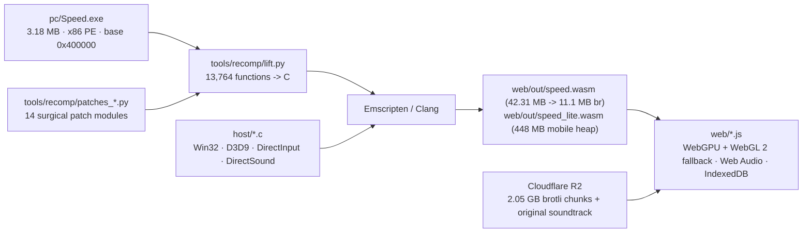

# Architecture: Static Recompilation of Need for Speed Underground (2003) to WebAssembly

Live game: **[https://nfsu.cc/](https://nfsu.cc/)** · Reverse Engineering Atlas: **[https://nfsu.cc/re/index.html](https://nfsu.cc/re/index.html)** · Engineering Devlog: **[https://nfsu.cc/devlog/index.html](https://nfsu.cc/devlog/index.html)**

This document explains how `RE-NFSU` translates the original 2003 Windows x86 executable (`pc/Speed.exe`) ahead of time into WebAssembly and runs it on WebGPU / WebGL 2 with no x86 emulator and no source-code rewrite.

## 1. End-to-End Pipeline

## 2. Static Recompiler (`tools/recomp/`)

| Component | Role |
|---|---|
| `lift.py` | Lifts 32-bit x86 instructions from `Speed.exe` (md5 `b6b9232c55376b3c38c56aac1f8a121d`) into portable C functions. |
| `abk.py` + flag liveness (`8444027`) | Tracks intra- and inter-procedural x86 EFLAGS liveness (`FlagABI`) and strips dead flag updates into plain C arithmetic. |
| `CHK_IMG` & `CHK_SP` (`69f51fb`, `fc8ef2e`) | Bypasses bounds checks on constant PE image addresses and coalesces per-push/pop stack checks into one check per straight-line `esp` block. |
| `RN_FAST_X87` / `RN_STRICT_X87` (`host/rt.h`) | Fast IEEE-754 double x87 math in shipped game builds; strict trace mode in `difftest.py`. |
| `difftest.py` | Single-function differential tester (`RN_ONLY=<addr> tools/recomp/difftest.py`) verifying lifted C against reference execution traces. |
| `patches_*.py` (14 modules) | Address-cited surgical patches (`patches_feel.py`, `patches_race.py`, `patches_render.py`, `patches_audio.py`, etc.). **Original 2003** mode stays untouched. |

## 3. Browser Host & Graphics (`host/`, `web/`)

- **DirectX 9 -> WebGPU + WebGL 2 (`host/d3d9.c`, `host/gpu.c`, `host/sm1.c`, `web/gpu.js`, `web/webgpu_gl.js`)**:
  - Translates fixed-function pipeline states and Shader Model 1 shaders to WGSL/GLSL.
  - **`RN_S3TC` (`00e474c`)**: Keeps DXT1/3/5 textures compressed on the GPU as native `bc1/bc2/bc3-rgba-unorm` (WebGPU) or `WEBGL_compressed_texture_s3tc` (WebGL 2), eliminating CPU decode stalls and cutting texture VRAM 4x-8x.
  - **Zero-waste draw pipeline (`deb8f28`)**: Compact dynamic UBO slicing and post-process `bindGroup` caching minimize per-frame allocations.
  - **Memory lifecycle (`511830f`)**: CPU-side `SmoothEnt` vertex/index shadows are freed immediately after GPU upload to prevent long-session OOMs.
- **Adaptive frame-time controller (`web/stats.js`, `web/quality.js`)**:
  - `host/d3d9.c` maintains an always-on 256-frame `Present()` ring (`40e6aff`).
  - `web/quality.js` (`b9c9753`) adjusts `resolution -> motion blur -> post effects -> fps -> tier` automatically while preserving the full 2003 soundtrack (`9545ee5`).
- **Input, Audio & Saves**:
  - DirectInput mapped to keyboard, Gamepad API (`web/pad.js`), and mobile touch overlay (`web/touch.js`).
  - DirectSound mapped to Web Audio (`web/audio.js`) with graceful fallback when autoplay/audio context is restricted (`921e827`).
  - Saves stored locally in `IndexedDB` (`web/saves.js`) with JSON export/import in the launcher.

## 4. Dual WASM Packaging & Cloudflare R2 Delivery (`tools/build_public.py`, `tools/upload_r2.sh`)

- **Desktop build (`speed.wasm`)**: Full WASM heap for desktop browsers.
- **Mobile lite build (`speed_lite.wasm`)**: 448 MB WASM heap (`GUEST_MEM` 256 MB, `511830f`) for iOS Safari and 4 GB Android devices.
- **Compression**: Both WASM binaries and `Speed.exe` are uploaded pre-compressed with Brotli `-q 11 -w 24` (`Content-Encoding: br`, `Content-Type: application/wasm`).
- **On-demand streaming**: The 2.05 GB 2003 asset set is served via HTTP Range / Brotli chunks from Cloudflare R2 so initial boot transfers ~32.6 MB to the main menu.

## 5. Reverse Engineering Corpus (`docs/re/`, `census/`)

- **[44 subsystem monographs](docs/re/README.md)** (also published as an indexed web atlas at [nfsu.cc/re/index.html](https://nfsu.cc/re/index.html) with raw `.md` mirrors) covering physics, camera, rival AI, traffic, tracks, render, sound, gameflow, and asset formats.
- **57 symbol census tables** (`census/names_*.tsv`) mapping `Speed.exe` function addresses with evidence tags (**V** verified in code/bytes, **I** inferred, **U** open).
