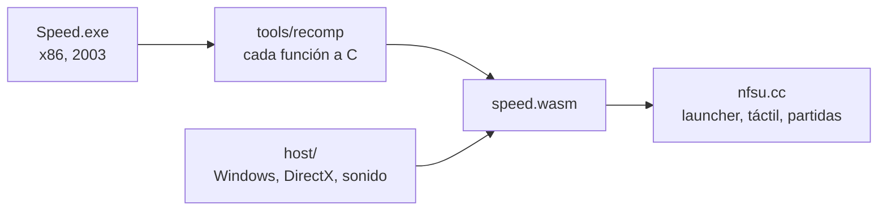

<div align="center">

<a href="https://nfsu.cc"></a>

# Juega Need for Speed Underground online, en tu navegador

**El juego de PC de 2003, gratis en una pestaña del navegador: sin descargar, sin instalar, sin emulador. Abre [nfsu.cc](https://nfsu.cc) y corre en computadora o celular.**

<a href="https://nfsu.cc"></a>


[English](README.md) · **Español**

[Jugar](#jugar) · [Qué trae](#qué-trae) · [Por qué funciona](#por-qué-funciona) · [Guías](#guías) · [Preguntas frecuentes](#preguntas-frecuentes) · [Mapa del repo](#mapa-del-repo)

</div>

## Jugar

1. Abre **[nfsu.cc](https://nfsu.cc)** en Chrome, Edge, Firefox o Safari ([qué versiones](https://nfsu.cc/blog/es/navegadores-celulares-ajustes-rendimiento.html)).
2. Pulsa **Jugar** para el menú principal del juego, o **Carrera** para ir directo a Go Underground.
3. Maneja con teclado, mando o los controles táctiles. Tu perfil y tus partidas se quedan en tu navegador.

## Qué trae

| Juego | Versiones | Dispositivos | Controles | Música |
|---|---|---|---|---|
| El juego de 2003 completo: carrera rápida, la carrera Go Underground, garage y tuning, Olympic City de noche | **Original 2003**, como salió, o **Remaster**, con bloom, bordes suavizados y pintura más nítida. <kbd>F4</kbd> cambia | Computadoras, Android, iPhone y iPad (WebGPU + respaldo automático WebGL 2; build ligero de 448 MB en celulares) | Teclado, mando, táctil. Se reasignan en el launcher | El soundtrack completo, todas las canciones |

<table>
<tr>
<td width="50%"></td>
<td width="50%"></td>
</tr>
<tr>
<td align="center"><b>Olympic City</b><br><sub>La ciudad como salió en 2003, en Chrome</sub></td>
<td align="center"><b>Launcher</b><br><sub>Calidad, versión, volumen y controles, con el estilo de los menús del juego</sub></td>
</tr>
<tr>
<td></td>
<td></td>
</tr>
<tr>
<td align="center"><b>Selección de coche</b><br><sub>Los menús originales</sub></td>
<td align="center"><b>Celulares</b><br><sub>El mismo build, con controles táctiles</sub></td>
</tr>
</table>

## Por qué funciona

Nada emula una PC mientras juegas. El código del propio juego corre en la página, así que maneja, suena y compite como en 2003.

| | El código del juego | Lo que le daba Windows | Los archivos del juego |
|---|---|---|---|
| Cómo | `Speed.exe` se traduce una vez, por adelantado: sus 13,764 funciones pasan a C y luego a un solo programa WebAssembly | La página contesta cada llamada que el juego le hace a Windows: DirectX 9 dibuja con WebGPU (WebGL 2 de respaldo), DirectInput lee teclado, mando y táctil, DirectSound suena con Web Audio | Se sirven desde Cloudflare en piezas comprimidas, se bajan cuando el juego las abre y el navegador las guarda |
| Resultado | La misma física, los mismos rivales y menús que el original | Un solo build para cada dispositivo | Un programa de 11 MB, y luego solo los datos que pide la siguiente pantalla |
| Código | [`tools/recomp/`](tools/recomp) | [`host/`](host), [`web/`](web) | [`tools/build_public.py`](tools/build_public.py) |
| Más | [Recompilación estática](https://nfsu.cc/blog/es/recompilacion-estatica-x86-a-webassembly.html) | [DirectX 9 sobre WebGPU](https://nfsu.cc/blog/es/directx-9-y-windows-sobre-webgpu.html) | [Alojar 2 GB](https://nfsu.cc/blog/es/alojar-un-juego-de-2-gb-en-cloudflare-r2-tiempo-de-carga.html) |



Los cambios al juego son parches pequeños en [`tools/recomp/patches_*.py`](tools/recomp), y cada uno nombra la dirección de `Speed.exe` que lo justifica. **Original 2003** deja el juego como salió; los efectos y opciones de manejo extra son del **Remaster**.

## Atlas de Ingeniería Inversa, Bitácora y Arquitectura

`RE-NFSU` forma parte de la ola actual de recompilación estática (junto a proyectos como N64Recomp, XenonRecomp y NFSU2Recomp), con toda la evidencia del binario abierta:

- **[Arquitectura (`ARCHITECTURE.md`)](ARCHITECTURE.md)** — pipeline completo x86 → C → WASM (`Speed.exe` 3.18 MB, 13,764 funciones, poda de flags muertos, coalescing `CHK_SP`, texturas BC1/2/3 en WebGPU/WebGL 2, WASM móvil de 448 MB).
- **[Atlas de Ingeniería Inversa (44 subsistemas)](https://nfsu.cc/re/es/index.html)** ([`docs/re/`](docs/re/README.md)) — direcciones verificadas de `Speed.exe` y estructuras de física, cámara, rivales, tráfico, pistas, render, sonido, garaje y assets (HTML + `.md` limpio).
- **[Bitácora de Ingeniería / Devlog](https://nfsu.cc/devlog/es/index.html)** ([`CHANGELOG.md`](CHANGELOG.md) · [Atom RSS](https://nfsu.cc/feed.xml)) — reportes con commits y métricas reales sobre el recompilador, WebGPU y telemetría de crashes.
- **Índice para IA / LLMs**: [`llms.txt`](https://nfsu.cc/llms.txt) · [`llms-full.txt`](https://nfsu.cc/llms-full.txt)

## Guías

| Jugar | [Jugar online](https://nfsu.cc/blog/es/jugar-need-for-speed-underground-online.html) | [Controles](https://nfsu.cc/blog/es/controles-need-for-speed-underground-teclado-mando-celular.html) | [Navegadores, celulares, ajustes](https://nfsu.cc/blog/es/navegadores-celulares-ajustes-rendimiento.html) |
|---|---|---|---|
| **Datos del juego** | [Lista de 20 Autos](https://nfsu.cc/blog/es/lista-autos-need-for-speed-underground.html) | [Soundtrack (26 canciones)](https://nfsu.cc/blog/es/soundtrack-need-for-speed-underground.html) | [33 Trucos PC](https://nfsu.cc/blog/es/trucos-need-for-speed-underground-pc.html) · [Guía Carrera](https://nfsu.cc/blog/es/guia-modo-carrera-need-for-speed-underground.html) |
| **Cómo corre** | [Cómo corre en el navegador](https://nfsu.cc/blog/es/como-corre-need-for-speed-underground-en-el-navegador-webassembly.html) | [Recompilación estática](https://nfsu.cc/blog/es/recompilacion-estatica-x86-a-webassembly.html) | [DirectX 9 y Windows sobre WebGPU](https://nfsu.cc/blog/es/directx-9-y-windows-sobre-webgpu.html) |
| **Dentro y prensa** | [Atlas RE (49 subsistemas)](https://nfsu.cc/re/es/index.html) | [Bitácora técnica](https://nfsu.cc/devlog/es/index.html) | [Kit de Prensa](https://nfsu.cc/press/es/index.html) · [Todas las guías](https://nfsu.cc/blog/es/index.html) |

## Preguntas frecuentes

- **¿Es un emulador o un remake?** Ninguno de los dos. `Speed.exe` (PC, 2003, x86) se recompila estáticamente por adelantado a WebAssembly, así que la física, los rivales, los menús y la carrera son el código original del juego.
- **¿Requiere WebGPU?** No. Usa WebGPU cuando está disponible y cambia automáticamente a WebGL 2 (`web/webgpu_gl.js`) en navegadores y celulares más viejos.
- **¿Trae el soundtrack original?** Sí, incluye todas las canciones del lanzamiento de PC de 2003.
- **¿Dónde se guardan las partidas?** Localmente en tu navegador (`IndexedDB`), con respaldo y restauración en un archivo desde el launcher.

## Mapa del repo

| Carpeta | [`tools/recomp`](tools/recomp) | [`host`](host) | [`web`](web) | [`census`](census) | [`docs/re`](docs/re) |
|---|---|---|---|---|---|
| Tiene | El traductor y los parches | Windows, DirectX y sonido para el navegador | La página, el launcher, los controles táctiles | Cada función de `Speed.exe`, con nombre | Una nota por sistema del juego |

<details>
<summary><b>Compilar y correr</b></summary>

```sh
.venv/bin/python tools/recomp/build.py web   # traducir y compilar
tools/serve.py                               # servir en :5180
node tools/webcheck.mjs --route              # prueba de arranque en Chrome headless
```

El build necesita una copia comprada del juego en la máquina.

| Fuera de git | `pc/Speed.exe` | `game/` | `build/`, `dist/`, `web/out/` |
|---|---|---|---|
| Por qué | El programa original se queda fuera | Los datos del juego se quedan fuera | Los hace de nuevo el build |

</details>

---

<sub>Proyecto de fans para investigación personal, hecho a partir de una copia comprada del juego. `Speed.exe` y los archivos de instalación del juego no están en este repositorio. Sin relación con Electronic Arts ni respaldo de su parte. Need for Speed es una marca de Electronic Arts Inc.</sub>
