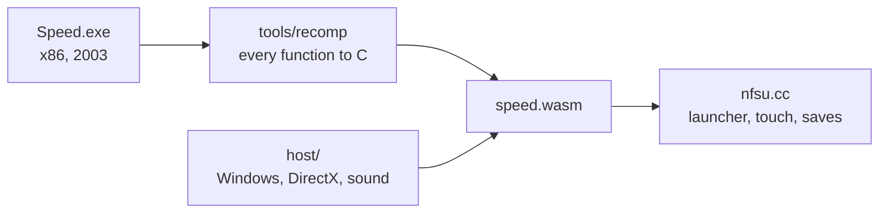

<div align="center">

<a href="https://nfsu.cc"></a>

# Play Need for Speed Underground online, in your browser

**The 2003 PC game, free in a browser tab: no download, no install, no emulator. Open [nfsu.cc](https://nfsu.cc) and race on a computer or a phone.**

<a href="https://nfsu.cc"></a>


**English** · [Español](README.es.md)

[Play](#play) · [What you get](#what-you-get) · [Why it works](#why-it-works) · [Guides](#guides) · [FAQ](#faq) · [Repo map](#repo-map)

</div>

## Play

1. Open **[nfsu.cc](https://nfsu.cc)** in Chrome, Edge, Firefox or Safari ([which versions](https://nfsu.cc/blog/en/browsers-phones-performance-settings.html)).
2. Press **Play** for the game's main menu, or **Career** to go straight to Go Underground.
3. Drive with the keyboard, a gamepad or the touch controls. Your profile and saves stay in your browser.

## What you get

| Game | Versions | Devices | Controls | Music |
|---|---|---|---|---|
| The whole 2003 game: Quick Race, Go Underground career, garage and tuning, Olympic City at night | **Original 2003**, as it shipped, or **Remaster**, with bloom, edge smoothing and sharper paint. <kbd>F4</kbd> switches | Computers, Android, iPhone and iPad (WebGPU + automatic WebGL 2 fallback; 448 MB lite build on phones) | Keyboard, gamepad, touch. Rebind in the launcher | The full soundtrack, every song |

<table>
<tr>
<td width="50%"></td>
<td width="50%"></td>
</tr>
<tr>
<td align="center"><b>Olympic City</b><br><sub>The city as shipped in 2003, running in Chrome</sub></td>
<td align="center"><b>Launcher</b><br><sub>Quality, version, volume and controls, in the game's menu style</sub></td>
</tr>
<tr>
<td></td>
<td></td>
</tr>
<tr>
<td align="center"><b>Car select</b><br><sub>The original menus</sub></td>
<td align="center"><b>Phones</b><br><sub>The same build, with touch controls</sub></td>
</tr>
</table>

## Why it works

Nothing emulates a PC while you play. The game's own code runs in the page, so it drives, sounds and races the way it did in 2003.

| | The game's code | What Windows gave it | The game's files |
|---|---|---|---|
| How | `Speed.exe` is translated once, ahead of time: all 13,764 of its functions become C, then one WebAssembly program | The page answers every call the game makes to Windows: DirectX 9 draws through WebGPU (WebGL 2 as a fallback), DirectInput reads keyboard, pad and touch, DirectSound plays through Web Audio | Served from Cloudflare in compressed pieces, fetched when the game opens them and kept by the browser |
| Result | Same physics, rivals and menus as the original | One build for every device | An 11 MB program, then only the data the next screen needs |
| Code | [`tools/recomp/`](tools/recomp) | [`host/`](host), [`web/`](web) | [`tools/build_public.py`](tools/build_public.py) |
| Read more | [Static recompilation](https://nfsu.cc/blog/en/static-recompilation-x86-to-webassembly.html) | [DirectX 9 on WebGPU](https://nfsu.cc/blog/en/directx-9-and-windows-on-webgpu.html) | [Hosting 2 GB](https://nfsu.cc/blog/en/hosting-a-2-gb-game-on-cloudflare-r2-load-time.html) |



Changes to the game are small patches in [`tools/recomp/patches_*.py`](tools/recomp), each naming the address in `Speed.exe` that justifies it. **Original 2003** keeps the game as it shipped; the extra effects and handling options belong to **Remaster**.

## Reverse Engineering Atlas, Devlog & Architecture

`RE-NFSU` is part of the static recompilation wave (alongside projects like N64Recomp, XenonRecomp, and NFSU2Recomp), with all binary evidence published openly:

- **[Architecture Blueprint (`ARCHITECTURE.md`)](ARCHITECTURE.md)** — end-to-end x86-to-C-to-WASM pipeline (`Speed.exe` 3.18 MB, 13,764 lifted functions, dead-flag pruning, `CHK_SP` coalescing, `RN_S3TC` BC1/2/3 WebGPU/WebGL 2, 448 MB mobile WASM).
- **[Reverse Engineering Atlas (44 Subsystems)](https://nfsu.cc/re/index.html)** ([`docs/re/`](docs/re/README.md)) — verified `Speed.exe` addresses and structs for physics, camera, rivals, traffic, tracks, rendering, audio, garage, and assets (HTML + raw `.md` mirrors).
- **[Engineering Devlog & Updates](https://nfsu.cc/devlog/index.html)** ([`CHANGELOG.md`](CHANGELOG.md) · [Atom RSS](https://nfsu.cc/feed.xml)) — commit-backed write-ups on compiler passes, WebGPU draw batching, and production crash telemetry.
- **AI / LLM Index**: [`llms.txt`](https://nfsu.cc/llms.txt) · [`llms-full.txt`](https://nfsu.cc/llms-full.txt)

## Guides

| Play | [Play online](https://nfsu.cc/blog/en/play-need-for-speed-underground-online.html) | [Controls](https://nfsu.cc/blog/en/need-for-speed-underground-controls-keyboard-gamepad-phone.html) | [Browsers, phones, settings](https://nfsu.cc/blog/en/browsers-phones-performance-settings.html) |
|---|---|---|---|
| **Game data** | [20-Car List](https://nfsu.cc/blog/en/need-for-speed-underground-car-list.html) | [26-Track Soundtrack](https://nfsu.cc/blog/en/need-for-speed-underground-soundtrack.html) | [33 PC Cheats](https://nfsu.cc/blog/en/need-for-speed-underground-cheat-codes.html) · [Career Guide](https://nfsu.cc/blog/en/need-for-speed-underground-career-events-guide.html) |
| **How it runs** | [How it runs in a browser](https://nfsu.cc/blog/en/how-need-for-speed-underground-runs-in-a-browser-webassembly.html) | [Static recompilation](https://nfsu.cc/blog/en/static-recompilation-x86-to-webassembly.html) | [DirectX 9 and Windows on WebGPU](https://nfsu.cc/blog/en/directx-9-and-windows-on-webgpu.html) |
| **Inside & press** | [RE Atlas (49 subsystems)](https://nfsu.cc/re/index.html) | [Engineering Devlog](https://nfsu.cc/devlog/index.html) | [Press Kit](https://nfsu.cc/press/index.html) · [All guides](https://nfsu.cc/blog/en/index.html) |

## FAQ

- **Is this an emulator or a remake?** Neither. `Speed.exe` (2003 PC, x86) is statically recompiled ahead of time into WebAssembly, so physics, AI rivals, menus, and career progression are the original game's code.
- **Does it require WebGPU?** No. WebGPU is used when available, with an automatic WebGL 2 fallback (`web/webgpu_gl.js`) for older browsers and phones.
- **Does it include the original soundtrack?** Yes, every song from the 2003 PC release is included.
- **Where are saves stored?** Locally in your browser (`IndexedDB`), with one-click backup and restore in the launcher.

## Repo map

| Folder | [`tools/recomp`](tools/recomp) | [`host`](host) | [`web`](web) | [`census`](census) | [`docs/re`](docs/re) |
|---|---|---|---|---|---|
| Holds | The translator and the patches | Windows, DirectX and sound for the browser | The page, launcher, touch controls | Every function of `Speed.exe`, named | One note per system of the game |

<details>
<summary><b>Build and run</b></summary>

```sh
.venv/bin/python tools/recomp/build.py web   # translate and compile
tools/serve.py                               # serve on :5180
node tools/webcheck.mjs --route              # boot check in headless Chrome
```

The build needs a bought copy of the game on the machine.

| Not in git | `pc/Speed.exe` | `game/` | `build/`, `dist/`, `web/out/` |
|---|---|---|---|
| Why | The original program stays out | Game data stays out | Made again by the build |

</details>

---

<sub>Fan project for personal research, made from a bought copy of the game. `Speed.exe` and the game's install files are not stored in this repository. Not affiliated with or endorsed by Electronic Arts. Need for Speed is a trademark of Electronic Arts Inc.</sub>
